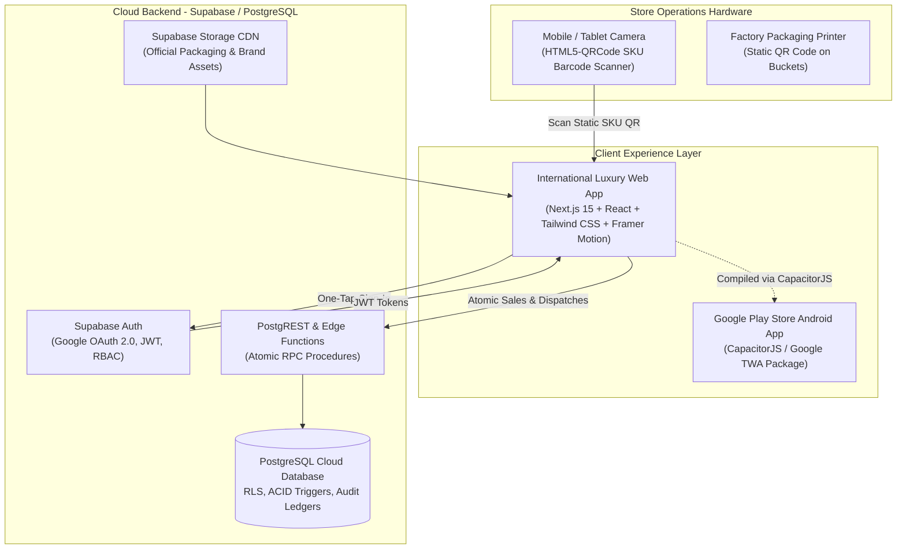
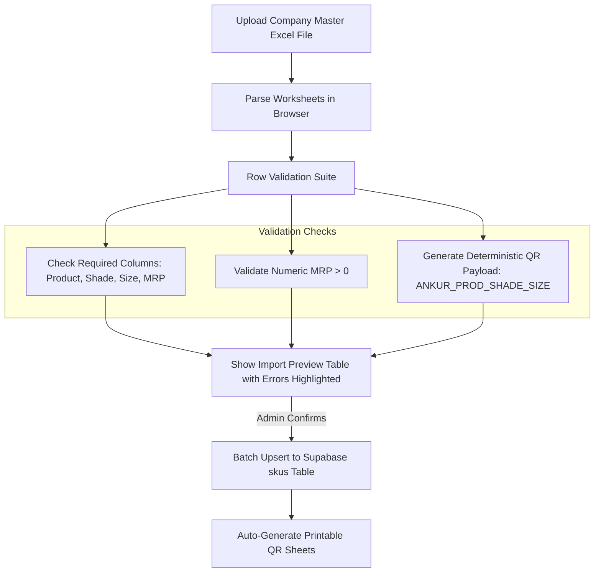

# Ankur Paints — Technical Architecture & System Design Specification

**Document Version:** 2.0.0  
**Phase:** Modern Responsive Web Platform & Hybrid Android App Architecture (`DEC-017`)  
**Date:** 2026-10-21  
**Status:** Approved Architecture Blueprint  
**Authors:** Senior Software Architect  
**Approved Baseline:** International-Grade Web Platform with Google Play Store APK/AAB Export

---

## 1. Executive Summary & Architectural Principles

The Ankur Paints platform is designed as an international-grade, high-performance, real-time B2B digital operations platform connecting central manufacturing/warehouse management with independent retail partners.

Built using a **unified responsive web architecture** (Next.js 15, Tailwind CSS, Framer Motion, GSAP, Supabase PostgreSQL), it provides a consumer-grade desktop and mobile browser experience that seamlessly compiles into an installable Android APK/AAB for Google Play Store distribution via CapacitorJS / Google Trusted Web Activities (TWA).

### Core Architectural Tenets
1. **Unified International Web Platform:** A single modern codebase serving desktop, tablet, and smartphone form factors with fluid luxury animations, zero device fragmentation, and instant over-the-air updates.
2. **Seamless Play Store Export:** Exportable directly to Google Play Store using CapacitorJS / Google TWA (`.apk` / `.aab`), giving retailers a 100% native mobile app feel with camera barcode scanning, offline caching, and push notifications.
3. **Zero Negative Stock Guarantee:** All inventory movements are strictly checked against physical availability. Retail sales exceeding live stock are atomically blocked at the database engine level.
4. **Double-Entry Ledger Accounting:** Inventory and incentive calculations do not mutate loose counter columns; every movement is recorded as an immutable debit/credit in an audit ledger (`stock_transactions`).
5. **Database-Enforced Price Ceilings:** The business rule $\text{Selling Price} \le \text{MRP}$ is enforced as an invariant both client-side and server-side via PostgreSQL database check constraints.
6. **Strict Multi-Tenant Isolation:** PostgreSQL Row Level Security (RLS) ensures that retail stores operate in total data isolation; no retailer can view or query competitor stock, sales, or incentive earnings.
7. **One-Tap Google Authentication & Instant KYC:** Frictionless onboarding using Supabase Auth (Google One-Tap OAuth), immediately capturing retailer Store Name, GSTIN, and Mobile Number.

---

## 2. System Architecture & Component Diagram

The platform utilizes a modern, unified cloud architecture:



---

## 3. Supabase PostgreSQL Entity-Relationship Diagram (ERD)

```mermaid
erDiagram
    PROFILES ||--o{ RETAILER_INVENTORY : "holds"
    PROFILES ||--o{ DISPATCHES : "receives"
    PROFILES ||--o{ SALES : "submits"
    PROFILES ||--o{ RETAILER_INCENTIVES : "earns"
    
    PRODUCTS ||--o{ SKUS : "categorizes"
    
    SKUS ||--o{ RETAILER_INVENTORY : "tracked_in"
    SKUS ||--o{ DISPATCH_ITEMS : "included_in"
    SKUS ||--o{ SALE_ITEMS : "sold_in"
    SKUS ||--o{ STOCK_TRANSACTIONS : "ledger_records"

    DISPATCHES ||--|{ DISPATCH_ITEMS : "contains"
    
    SALES ||--|{ SALE_ITEMS : "contains"
    SALES ||--o{ RETAILER_INCENTIVES : "generates"
    
    INCENTIVE_SCHEMES ||--|{ SCHEME_SLABS : "defines"
    INCENTIVE_SCHEMES ||--o{ RETAILER_INCENTIVES : "rewards_under"

    PROFILES {
        uuid id PK
        string full_name
        string store_name
        string phone UK
        enum role "admin | retailer | warehouse"
        boolean is_active
        timestamp created_at
    }

    PRODUCTS {
        uuid id PK
        string name
        string category
        string description
        boolean is_active
        timestamp created_at
    }

    SKUS {
        uuid id PK
        uuid product_id FK
        string product_name
        string shade_code
        string shade_name
        numeric pack_size
        string pack_unit "L | KG | ML"
        numeric mrp "Printed Maximum Retail Price"
        string qr_code_payload UK "Static SKU Payload"
        boolean is_active
        timestamp created_at
    }

    RETAILER_INVENTORY {
        uuid id PK
        uuid retailer_id FK
        uuid sku_id FK
        numeric current_stock "Non-negative"
        timestamp last_updated_at
    }

    STOCK_TRANSACTIONS {
        uuid id PK
        uuid retailer_id FK
        uuid sku_id FK
        enum transaction_type "DISPATCH_RECEIVED | SALE_DEDUCTION | RETURN_OUTWARD | AUDIT_ADJUSTMENT"
        numeric quantity_delta "Positive or Negative"
        numeric balance_after
        uuid reference_id "dispatch_id or sale_id"
        uuid created_by FK
        timestamp created_at
    }

    DISPATCHES {
        uuid id PK
        string dispatch_number UK
        uuid retailer_id FK
        uuid dispatched_by FK
        enum status "SUBMITTED | ACKNOWLEDGED"
        numeric total_items
        text notes
        timestamp created_at
    }

    DISPATCH_ITEMS {
        uuid id PK
        uuid dispatch_id FK
        uuid sku_id FK
        numeric quantity
    }

    SALES {
        uuid id PK
        string invoice_number UK
        uuid retailer_id FK
        string customer_name
        string customer_mobile
        numeric total_amount
        numeric total_incentive_accrued
        uuid idempotency_key UK
        timestamp created_at
    }

    SALE_ITEMS {
        uuid id PK
        uuid sale_id FK
        uuid sku_id FK
        numeric quantity
        numeric mrp
        numeric selling_price "Must be <= mrp"
        numeric line_total
        numeric incentive_amount
    }

    INCENTIVE_SCHEMES {
        uuid id PK
        string title
        text description
        timestamp start_date
        timestamp end_date
        boolean is_active
        string banner_url "Flipkart-style graphic"
        string theme_color
        uuid created_by FK
        timestamp created_at
    }

    SCHEME_SLABS {
        uuid id PK
        uuid scheme_id FK
        numeric target_amount "e.g. 100000"
        numeric reward_percentage "e.g. 10.0"
        string reward_description "e.g. 10% Gold Tier Bonus"
        integer tier_order
    }

    RETAILER_INCENTIVES {
        uuid id PK
        uuid retailer_id FK
        uuid scheme_id FK
        uuid sale_id FK
        numeric qualified_amount
        numeric reward_percentage
        numeric incentive_earned
        enum status "ACCRUED | APPROVED | PAID | REVERSED"
        timestamp created_at
    }
```



---

## 4. Database Schema Specifications & Constraints

### 4.1 Invariant Constraints (Hard Business Rules)
To guarantee data integrity regardless of frontend behavior, the PostgreSQL schema enforces:
1. **Price Ceiling Check:**  
   `ALTER TABLE sale_items ADD CONSTRAINT chk_selling_price_mrp CHECK (selling_price <= mrp);`  
   *Guarantees a retailer can never submit a transaction exceeding printed MRP.*
2. **Strict Non-Negative Stock Check:**  
   `ALTER TABLE retailer_inventory ADD CONSTRAINT chk_stock_non_negative CHECK (current_stock >= 0);`  
   *Ensures the database engine physically rejects any sale transaction that would cause stock to drop below zero.*
3. **Double-Submission Idempotency:**  
   `ALTER TABLE sales ADD CONSTRAINT uq_sales_idempotency UNIQUE (idempotency_key);`  
   *Prevents double-charging or duplicate inventory decrements during cellular connection retry attempts.*
4. **Positive Quantities:**  
   `ALTER TABLE dispatch_items ADD CONSTRAINT chk_dispatch_qty_positive CHECK (quantity > 0);`  
   `ALTER TABLE sale_items ADD CONSTRAINT chk_sale_qty_positive CHECK (quantity > 0);`

---

## 5. Transaction State Machines

### 5.1 Stock Lifecycle State Machine

```mermaid
stateDiagram-v2
    [*] --> FactoryDispatch: Warehouse scans SKU QR (Qty + 1 per scan)
    FactoryDispatch --> RetailerInventory: Admin submits dispatch
    note right of RetailerInventory: Stock balance incremented immediately in retailer_inventory
    RetailerInventory --> SaleValidation: Retailer scans multi-SKU cart
    
    state SaleValidation {
        [*] --> CheckStock
        CheckStock --> BlockSale: If Requested Qty > Current Stock
        CheckStock --> CheckPrice: If Stock is Available
        CheckPrice --> BlockSale: If Selling Price > Printed MRP
        CheckPrice --> Approved: If Price <= MRP
    }

    BlockSale --> [*]: Transaction Rejected (Error Toast)
    Approved --> SoldDeducted: Atomic Checkout
    note right of SoldDeducted: retailer_inventory decremented; ledger debit created; sale logged
    SoldDeducted --> [*]
```


### 5.2 Atomic Checkout Transaction Flow (Stored Procedure: `submit_retailer_sale`)
To eliminate race conditions when a retailer scans items rapidly or operates multiple cashiers, checkout is implemented as a PostgreSQL stored procedure (`RPC`):

```sql
CREATE OR REPLACE FUNCTION submit_retailer_sale(
    p_retailer_id UUID,
    p_customer_name TEXT,
    p_customer_mobile TEXT,
    p_idempotency_key UUID,
    p_items JSONB -- Array of {sku_id, quantity, selling_price}
) RETURNS JSONB AS $$
DECLARE
    v_sale_id UUID;
    v_item JSONB;
    v_sku_mrp NUMERIC;
    v_current_stock NUMERIC;
    v_line_total NUMERIC;
    v_total_amount NUMERIC := 0;
    v_total_incentive NUMERIC := 0;
    v_applicable_pct NUMERIC := 0;
BEGIN
    -- 1. Idempotency Check
    IF EXISTS (SELECT 1 FROM sales WHERE idempotency_key = p_idempotency_key) THEN
        RETURN jsonb_build_object('success', true, 'message', 'Sale already processed (idempotent duplicate)');
    END IF;

    -- 2. Validate Items, Lock Stock Rows, and Check Stock Ceilings
    FOR v_item IN SELECT * FROM jsonb_array_elements(p_items)
    LOOP
        -- Fetch MRP and verify item exists
        SELECT mrp INTO v_sku_mrp FROM skus WHERE id = (v_item->>'sku_id')::UUID;
        IF (v_item->>'selling_price')::NUMERIC > v_sku_mrp THEN
            RAISE EXCEPTION 'Price violation: Selling price (%) exceeds printed MRP (%)', 
                (v_item->>'selling_price')::NUMERIC, v_sku_mrp;
        END IF;

        -- Row-level lock on retailer inventory to prevent race conditions
        SELECT current_stock INTO v_current_stock 
        FROM retailer_inventory 
        WHERE retailer_id = p_retailer_id AND sku_id = (v_item->>'sku_id')::UUID 
        FOR UPDATE;

        IF v_current_stock IS NULL OR v_current_stock < (v_item->>'quantity')::NUMERIC THEN
            RAISE EXCEPTION 'Insufficient stock for SKU %. Available: %, Requested: %',
                v_item->>'sku_id', COALESCE(v_current_stock, 0), (v_item->>'quantity')::NUMERIC;
        END IF;

        v_line_total := (v_item->>'quantity')::NUMERIC * (v_item->>'selling_price')::NUMERIC;
        v_total_amount := v_total_amount + v_line_total;
    END LOOP;

    -- 3. Calculate Applicable Incentive Slab (e.g. 1L threshold -> 10%)
    SELECT COALESCE(MAX(reward_percentage), 0) INTO v_applicable_pct
    FROM scheme_slabs ss
    JOIN incentive_schemes isc ON ss.scheme_id = isc.id
    WHERE isc.is_active = true 
      AND NOW() BETWEEN isc.start_date AND isc.end_date
      AND v_total_amount >= ss.target_amount;

    v_total_incentive := (v_total_amount * v_applicable_pct) / 100;

    -- 4. Create Master Sale Record
    INSERT INTO sales (
        retailer_id, customer_name, customer_mobile, 
        total_amount, total_incentive_accrued, idempotency_key
    ) VALUES (
        p_retailer_id, p_customer_name, p_customer_mobile, 
        v_total_amount, v_total_incentive, p_idempotency_key
    ) RETURNING id INTO v_sale_id;

    -- 5. Insert Line Items, Decrement Inventory & Append to Stock Ledger
    FOR v_item IN SELECT * FROM jsonb_array_elements(p_items)
    LOOP
        v_line_total := (v_item->>'quantity')::NUMERIC * (v_item->>'selling_price')::NUMERIC;
        
        -- Insert line item
        INSERT INTO sale_items (
            sale_id, sku_id, quantity, mrp, selling_price, line_total, incentive_amount
        ) VALUES (
            v_sale_id, (v_item->>'sku_id')::UUID, (v_item->>'quantity')::NUMERIC,
            (SELECT mrp FROM skus WHERE id = (v_item->>'sku_id')::UUID),
            (v_item->>'selling_price')::NUMERIC, v_line_total,
            (v_line_total * v_applicable_pct) / 100
        );

        -- Decrement inventory
        UPDATE retailer_inventory
        SET current_stock = current_stock - (v_item->>'quantity')::NUMERIC,
            last_updated_at = NOW()
        WHERE retailer_id = p_retailer_id AND sku_id = (v_item->>'sku_id')::UUID;

        -- Record immutable audit ledger entry
        INSERT INTO stock_transactions (
            retailer_id, sku_id, transaction_type, quantity_delta, 
            balance_after, reference_id, created_by
        ) VALUES (
            p_retailer_id, (v_item->>'sku_id')::UUID, 'SALE_DEDUCTION', 
            -(v_item->>'quantity')::NUMERIC,
            (SELECT current_stock FROM retailer_inventory WHERE retailer_id = p_retailer_id AND sku_id = (v_item->>'sku_id')::UUID),
            v_sale_id, auth.uid()
        );
    END LOOP;

    -- 6. Log Incentive Accrual Record
    IF v_total_incentive > 0 THEN
        INSERT INTO retailer_incentives (
            retailer_id, sale_id, qualified_amount, reward_percentage, 
            incentive_earned, status
        ) VALUES (
            p_retailer_id, v_sale_id, v_total_amount, v_applicable_pct, 
            v_total_incentive, 'ACCRUED'
        );
    END IF;

    RETURN jsonb_build_object(
        'success', true, 
        'sale_id', v_sale_id, 
        'total_amount', v_total_amount,
        'incentive_earned', v_total_incentive
    );
END;
$$ LANGUAGE plpgsql SECURITY DEFINER;
```

---

## 6. Row Level Security (RLS) Policy Matrix

Every table has RLS enabled (`ALTER TABLE ... ENABLE ROW LEVEL SECURITY;`).

| Table | Retailer Role Permissions | Admin / Warehouse Role Permissions |
| :--- | :--- | :--- |
| `profiles` | SELECT own profile; UPDATE limited contact fields | SELECT all profiles; INSERT/UPDATE all |
| `products` | SELECT active products (`is_active = true`) | Full CRUD |
| `skus` | SELECT active SKUs (`is_active = true`) | Full CRUD (including bulk Excel import) |
| `retailer_inventory` | SELECT own inventory (`retailer_id = auth.uid()`) | SELECT all retailers' inventory |
| `stock_transactions` | SELECT own ledger (`retailer_id = auth.uid()`) | SELECT consolidated ledger |
| `dispatches` | SELECT dispatches addressed to self | Full CRUD (dispatch creation and history) |
| `dispatch_items` | SELECT items where parent dispatch belongs to self | Full CRUD |
| `sales` | SELECT own sales (`retailer_id = auth.uid()`); INSERT via atomic RPC | Full SELECT across all outlets |
| `sale_items` | SELECT items where parent sale belongs to self | Full SELECT across all outlets |
| `incentive_schemes` | SELECT active schemes (`is_active = true`) | Full CRUD (create/edit scheme banners) |
| `scheme_slabs` | SELECT slabs of active schemes | Full CRUD (configure thresholds & %) |
| `retailer_incentives` | SELECT own incentive earnings | Full CRUD (review & approve payout batches) |

---

## 7. International-Grade Luxury Web & Retailer UI Architecture

To meet the requirement for an engaging, luxury visual presentation with gamified retailer incentives:
1. **Fluid Micro-Interactions & Luxury Motion:**
   - Framer Motion and GSAP power fluid entrance choreographies, subtle floating elements, and smooth category transitions across all viewport sizes.
   - Zero square-cropped image borders in ambient backgrounds: lighting is driven by pure CSS radial gradient mesh auroras matching Ankur Cobalt Blue (`#004B87`) and Vermillion Orange (`#E8501E`).
2. **Dynamic Promotional Banners:**
   - Active schemes fetched from `incentive_schemes` render as hero carousel cards at the top of the Retailer dashboard.
   - Themes, gradient backgrounds, and festive badges (e.g. *"Diwali Dhamaka"*, *"Super Painter Fest"*) are driven dynamically from the database.
3. **Animated Target Progress Meters & Celebratory Confetti:**
   - A reactive progress bar calculates the retailer's current month/period sales volume against the active `scheme_slabs`.
   - **Example:** `"Achieved ₹75,000 / ₹1,00,000 — Just ₹25,000 away from unlocking 10% Extra Bonus!"`
   - Unlocked milestones trigger celebratory golden confetti particle animations using `canvas-confetti`.
4. **Cart-Level Incentive Simulator & MRP Ceilings:**
   - As the retailer scans paint buckets and enters selling prices, a live mini-counter calculates the estimated incentive earned on checkout.
   - Selling price is strictly guarded: entering a price higher than printed MRP locks checkout with a real-time crimson warning banner.

---

## 8. Technology Stack Specification & Architectural Role

| Technology / Library | Target Version | Architectural Role & Justification |
| :--- | :--- | :--- |
| **Next.js 15 (React 19)** | `15.x` | Core application framework. Server-Side Rendering (SSR) guarantees sub-second landing page delivery; App Router provides instant client-side routing between portal tabs. |
| **TypeScript** | `5.x` | Eliminates runtime errors and guarantees end-to-end schema consistency across database models, RPC inputs, and cart calculations. |
| **Tailwind CSS** | `3.4+ / 4.x` | Atomic, highly maintainable CSS styling engine. Configured with Ankur brand tokens, glassmorphic backdrops (`backdrop-blur-xl`), and ambient glow auroras. |
| **Framer Motion & GSAP** | Latest | Powers high-fidelity animations: floating bucket hero showcases, interactive shade visualizer swaps, and sleek modal reveals. |
| **Supabase Client (`@supabase/supabase-js`)** | `v2.x` | Direct, secure connection to PostgreSQL Cloud database (`wpiztkjuojirzsxvzqfv.supabase.co`) with WebSocket subscriptions and token lifecycle handling. |
| **Supabase Auth & Google OAuth** | `v2.x` | Frictionless Google One-Tap sign-in, JWT token generation, and automated `profiles` table synchronization via PostgreSQL trigger. |
| **Html5-Qrcode** | `2.3+` | High-accuracy in-browser and WebView camera scanner for standard UPC/EAN barcodes and custom Ankur QR codes (`ANKUR_{PROD}_{SHADE}_{SIZE}`). |
| **Canvas Confetti** | `1.9+` | Ultra-lightweight particle physics engine for celebrating retailer sales milestone completions and Diwali festive bonus unlocks. |
| **Lucide React** | `0.4+` | Clean, minimalist, high-DPI vector iconography for mobile and desktop interfaces. |
| **CapacitorJS / Google TWA** | `@capacitor/core` | Wraps the compiled responsive web application into an installable Android `.apk` / `.aab` for direct Google Play Store release. |

---

## 8. Bulk Excel Catalog Importer Engine

The Web Admin Dashboard incorporates a client-side parser (using `SheetJS / xlsx`) with rigorous validation before database ingestion:



---

## 9. Brand Identity, UI Design Tokens & Packaging Themes

The visual presentation is calibrated directly from official **Ankur Paints and Inks Private Limited** branding:

### 9.1 Core Corporate Colors & Palettes
- **Ankur Cobalt Blue (`#004B87`):** Primary brand authority. Used for navigation bars, primary headings, high-trust badges, and dark backdrops.
- **Paints Vermillion Orange (`#E8501E`):** Vibrant energetic accent. Used for primary CTAs, scan triggers, active badges, and conversion buttons.
- **Paintbrush Spectrum Arc:** Cyan (`#00B2E3`), Green (`#00A859`), Yellow (`#FFD100`), Orange (`#F37021`), Red (`#ED1C24`).
- **Luxury Dark Glassmorphic Canvas:** Deep Navy (`#030712`), Slate Navy (`#0F172A`), Surface Glass (`rgba(15, 23, 42, 0.75)` with `backdrop-blur-xl`).

### 9.2 Verified Product Line Themes (Physical Packaging Lineup)
| Product Line | Category | Packaging Theme Color | Warranty |
| :--- | :--- | :--- | :---: |
| **Epic Coat** | Exterior Emulsion (Flagship) | Royal Indigo (`#312E81`) | 5 Years |
| **Rang Ritu** | Interior Emulsion | Vibrant Magenta (`#BE185D`) | 7 Years |
| **Gleam Coat** | Exterior Emulsion | Sea Teal (`#0F766E`) | 3 Years |
| **Rose Gold** | Exterior Emulsion | Crimson Rust (`#991B1B`) | 2 Years |
| **Colour Crest** | Exterior Emulsion | Warm Amber (`#9A3412`) | 2 Years |
| **Damp Proof** | Interior & Exterior Waterproofing | Ochre Gold (`#854D0E`) | 10 Years |
| **Acrylic Distemper** | Washable Distemper | Fresh Leaf Green (`#166534`) | — |
| **Premium Wall Primer**| Undercoat / Primer | Emerald Mint (`#065F46`) | — |
| **Acrylic Wall Putty** | Surface Preparation / Putty | Golden Amber (`#A16207`) | — |

---

## 10. Sequential Implementation Roadmap

1. **Phase 1-7 (Completed):** Requirements, Technical ERD, Live Supabase Cloud Database (12 tables), Auth triggers, QR generator, Bulk Excel importer.
2. **Phase 8 (Active):** Next.js 15 Luxury Web Platform (Hero stage, interactive room visualizer, 9-bucket showcase, Google One-Tap authentication, Store KYC).
3. **Phase 9:** Barcode QR Scanner, Point-of-Sale cart ($\text{Selling Price} \le \text{MRP}$), Green Tick animated receipt, and Sales History Ledger.
4. **Phase 10:** CapacitorJS Android packaging for Google Play Store APK/AAB distribution.
